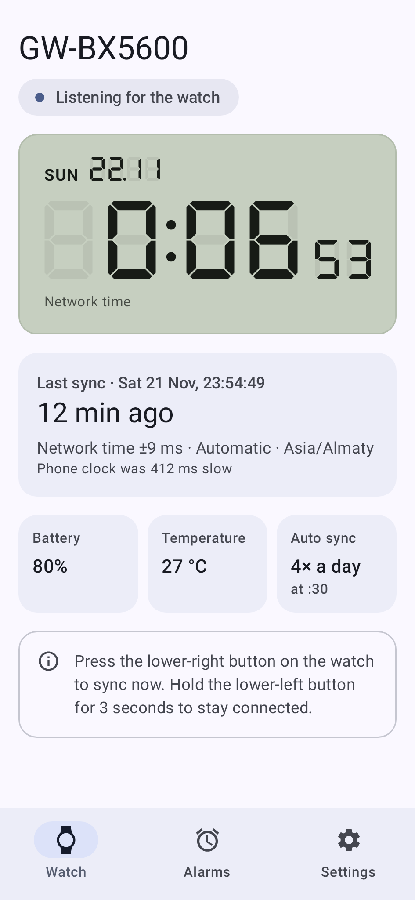
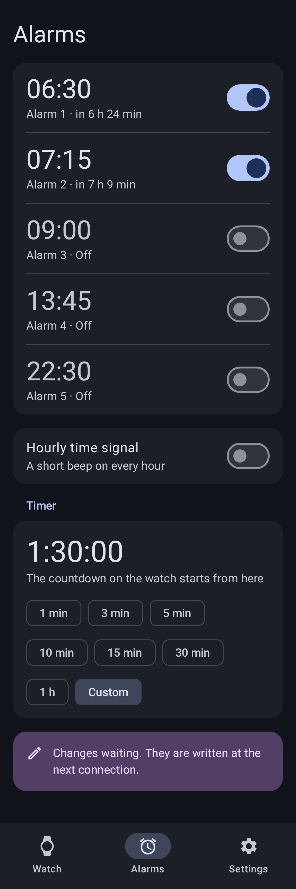
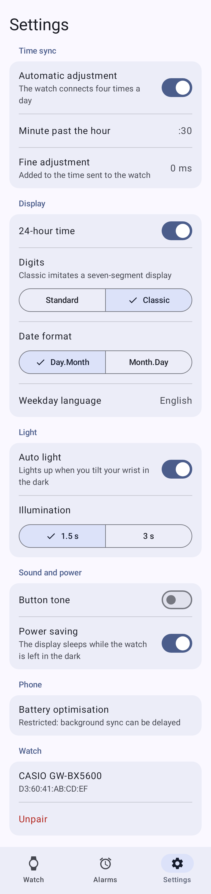
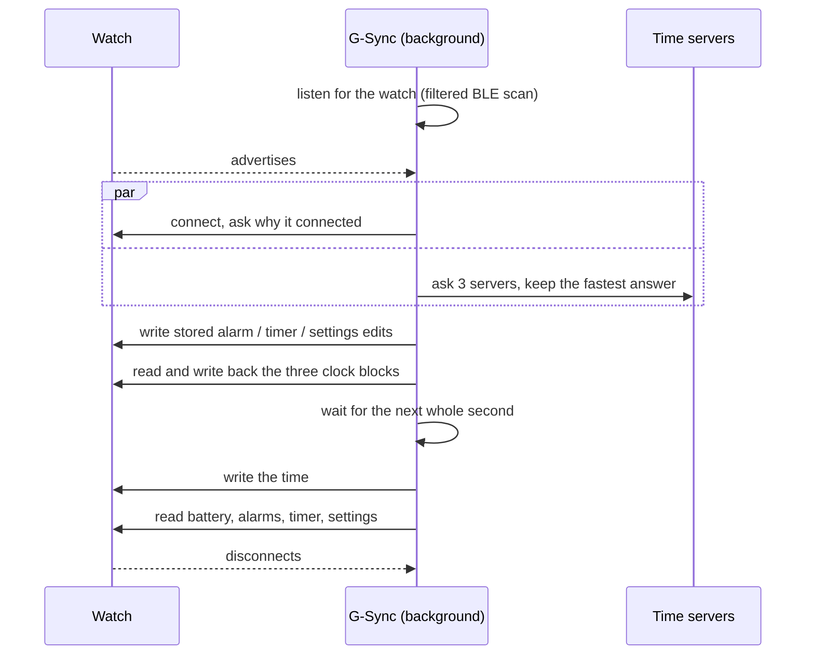

<div align="center">

# ⌚ G-Sync

**Your G-Shock, on the exact second.** A small, private Android companion for the Casio G-Shock GW-BX5600: network-accurate time, alarms, timer and every watch setting. No account.

[](https://github.com/krax1337/gsync/actions/workflows/ci.yml)
[](https://github.com/krax1337/gsync/releases/latest)
[](#-install)
[](LICENSE)

  

</div>

## ✨ Why

- 🎯 **Accurate.** Time comes from network time servers, not from whatever the phone thinks, and is written so that it lands on the watch as a second begins.
- 🔄 **Syncs by itself.** The app answers the watch's four daily connections in the background. You do not have to open it.
- 👀 **Checkable.** The first screen is a live clock showing what the watch should read. Hold the watch next to it.
- 🧰 **Complete, not bloated.** Time, alarms, timer, all watch settings and the phone finder. No calendar, no voice assistant, no button actions.
- 🔒 **Private.** No account, no analytics, no backend. The only thing it sends over the network is a time request.

Unofficial project, not affiliated with Casio. G-SHOCK and CASIO are trademarks of Casio Computer Co., Ltd.

> [!WARNING]
> **Early release.** Time sync is confirmed on a real GW-BX5600. Alarms, timer, settings, background sync and the phone finder have unit tests but have not yet been checked on hardware. If something is off on yours, please [open an issue](https://github.com/krax1337/gsync/issues).

## 📲 Install

Requirements: Android 13 or newer, a GW-BX5600.

1. **Download** `gsync-<version>.apk` from the [latest release](https://github.com/krax1337/gsync/releases/latest) and open it on the phone. Android asks once to allow installs from your browser or file manager.
2. **Allow** Bluetooth and notifications when the app asks.
3. **Pair:** hold the lower-left button on the watch for about 3 seconds until CONNECT appears, then tap the watch in the app.
4. **Battery:** in the app's Settings tab, tap "Battery optimisation" and choose "Unrestricted". Without it Android may delay background sync.

From then on the watch syncs four times a day. To sync right now, press the lower-right button on the watch.

<details>
<summary><b>💻 Install from a computer</b></summary>

```sh
adb install -r gsync-<version>.apk
adb shell cmd package compile -m speed -f io.github.krax1337.gsync   # optional: compile ahead of time, no warm-up
```

</details>

<details>
<summary><b>🔏 Verify the download</b></summary>

Every APK is built and signed by the [Release workflow](.github/workflows/release.yml) from the tagged commit.

```sh
sha256sum --check SHA256SUMS
apksigner verify --print-certs gsync-<version>.apk
```

The certificate SHA-256 digest must be:

```
2cb66bfd8bcafba9f6483453188b0a370e5be8294513471d598fc4fc8bcf0ac6
```

</details>

## 🧰 What it controls

| Area | What you can set |
| --- | --- |
| **Time** | Synced from network time on every connection; fine adjustment in milliseconds |
| **Automatic sync** | On or off, and the minute past the hour at which the watch connects |
| **Alarms** | Five alarms, hourly time signal |
| **Timer** | Countdown start value, with presets from 1 minute to 1 hour or any custom value |
| **Display** | 12/24-hour time, day.month or month.day, weekday language, Standard or Classic digits |
| **Light** | Auto light, 1.5 s or 3 s illumination |
| **Sound and power** | Button tone, power saving |
| **Phone finder** | Hold the lower-right button on the watch for five seconds and the phone rings, even on silent |

The Settings tab also has a **watch guide**: what each button does, how to set the home city and world time on the watch, which built-in city matches your phone's time zone, and what to do when you travel.

You can change alarms, timer and settings at any time. If the watch is not connected, the change is stored and written at its next connection: the next automatic sync at the latest, or right away when you press a button on the watch.

## 🔄 How a sync runs

The watch decides when to talk. Four times a day, and when you press the lower-right button, it advertises over Bluetooth for a short while. Holding the lower-left button does the same, but the watch then stays connected.



## 🎯 Accuracy

- **Source:** the best of three SNTP answers, carried forward by the phone's monotonic clock. Without network the phone clock is used, and the Watch tab says so.
- **Timing:** the time is read after all table exchanges, immediately before the write, and the write is held back so that it arrives as a second begins. The remaining error is about half a Bluetooth connection interval, a few hundredths of a second.
- **Calibration:** if your watch lands consistently early or late, "Fine adjustment" in Settings adds a constant offset.

## 🔒 Privacy and permissions

G-Sync has no account and no server. It stores the watch's Bluetooth address and the last values read from the watch, on the phone only and excluded from backups.

| Permission | Why |
| --- | --- |
| Nearby devices (Bluetooth scan and connect) | Find the watch, listen for it, talk to it. Declared as never used for location |
| Notifications | The status notification that keeps background sync alive |
| Internet | Time requests to `time.cloudflare.com`, `time.google.com` and `pool.ntp.org` |
| Foreground service, run at startup | Keep listening for the watch, also after a reboot |
| Wake lock | Keep the phone awake for the second or so an exchange takes |
| Ask to ignore battery optimisations | Lets you grant "Unrestricted" from inside the app |

While a watch is paired, Android shows a permanent "G-Sync" notification. That is what stops Android from freezing the app between syncs; you can hide the notification category in system settings.

## ⚠️ Status and limitations

- Only time sync is confirmed on hardware so far (see the warning above).
- One watch model: GW-BX5600. Other G-Shocks speak different protocols and are not supported.
- World-time cities are written back to the watch unchanged, and there is no home city picker. The home time follows the phone's time zone.
- The battery level uses the scale known for this model, which owners have reported as imprecise.
- Phones with aggressive battery managers (Xiaomi, Huawei, Samsung "sleeping apps") may need G-Sync excluded there too.

<details>
<summary><b>🛠 Build from source</b></summary>

The toolchain is pinned with [mise](https://mise.jdx.dev): JDK 25 and the Android command-line tools.

```sh
mise install        # once
mise run sdk        # once: SDK licences, platform and build tools
mise run test       # unit tests
mise run apk        # optimized APK in app/build/outputs/apk/release/
mise run install    # install it on the phone connected over adb
```

A local build is signed with your debug key, so it cannot update an installed release: uninstall that first.

Screens can be opened with sample data, without a watch, in a debug build:

```sh
adb shell am start -n io.github.krax1337.gsync/.ui.DemoActivity --es screen settings --ez dark true
```

</details>

<details>
<summary><b>🗺 How the code is laid out</b></summary>

About 4,700 lines of Kotlin and Jetpack Compose, no Bluetooth library.

| Part | Role |
| --- | --- |
| `protocol/` | Encoders and decoders for the Casio frames and clock blocks. Pure Kotlin, unit tested |
| `watch/WatchSession` | The operations: sync time, read and write alarms, timer, settings |
| `ble/GattLink` | The Bluetooth transport, directly on Android's GATT API |
| `watch/WatchManager` | Scan, connect, exchange, stored state. One per process |
| `sync/SyncService` | Foreground service that keeps the app listening; restarts on boot |
| `time/` | SNTP client and the network-backed clock |
| `ui/` | Compose screens. Stateless: `WatchState` in, `WatchActions` out |

The GW-BX5600 keeps its clock tables in three blocks on a second pair of Bluetooth characteristics and takes a new time only after all three were read and written back. `protocol/Time.kt` documents the layout.

</details>

## 🙏 Credits

The Casio protocol was reverse engineered by others. Frame and block layouts and the time zone coordinates are ported from [GShockAPI](https://github.com/izivkov/GShockAPI) by Ivo Zivkov (Apache-2.0), which builds on [Gadgetbridge](https://codeberg.org/Freeyourgadget/Gadgetbridge). The seven-segment digits are [DSEG](https://github.com/keshikan/DSEG) by Keshikan (SIL Open Font License 1.1).

Security policy and how to report a vulnerability: [SECURITY.md](SECURITY.md). Licence: [Apache-2.0](LICENSE).

## 🇷🇺 По-русски

Небольшое приложение для часов Casio G-Shock GW-BX5600: точное время из сети, будильники, таймер и все настройки часов. Без аккаунта, без аналитики.

- **Время** берётся с серверов точного времени и записывается так, чтобы попасть на часы ровно в начале секунды.
- **Синхронизация в фоне:** приложение само отвечает на четыре ежедневных подключения часов. Чтобы синхронизировать сразу, нажмите правую нижнюю кнопку на часах.
- **Первый экран** показывает время, которое должно быть на часах: поднесите часы и сравните.
- **Установка:** скачайте APK из [последнего релиза](https://github.com/krax1337/gsync/releases/latest), разрешите Bluetooth и уведомления, удерживайте левую нижнюю кнопку на часах около 3 секунд и выберите часы в приложении. В настройках приложения выберите для батареи режим «Без ограничений».

Синхронизация времени проверена на реальных часах. Будильники, таймер, настройки, фоновая синхронизация и поиск телефона пока нет.
