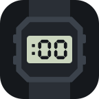
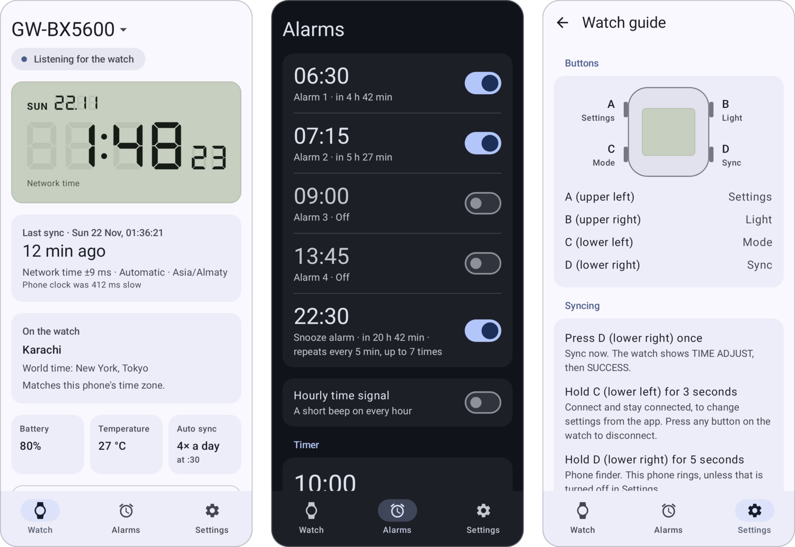
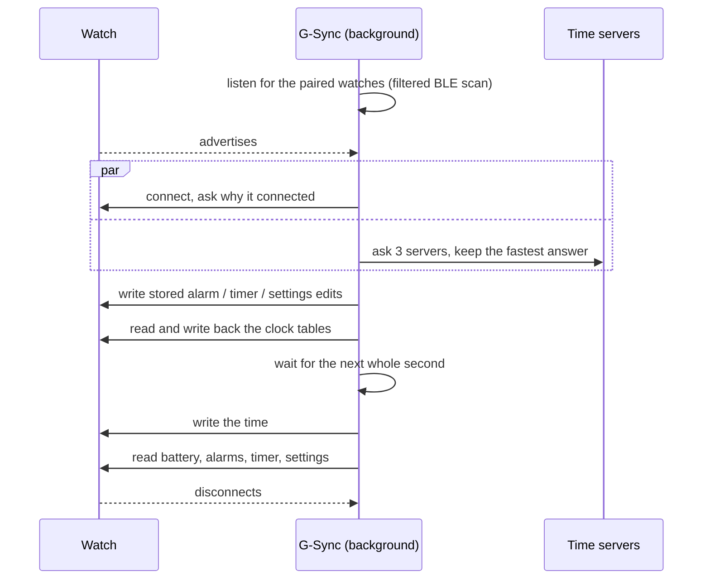

<div align="center">



# G-Sync

**Your G-Shock, on the exact second.** A small, private Android companion for Casio G-Shock watches: network-accurate time, alarms, timer and the watch's settings. No account.

[](https://github.com/krax1337/gsync/releases/latest)

[](https://github.com/krax1337/gsync/actions/workflows/ci.yml)
[](#-install)
[](LICENSE)



</div>

## ✨ Why

- 🎯 **Accurate.** Time comes from network time servers, not from whatever the phone thinks, and is written so that it lands on the watch as a second begins.
- 🔄 **Syncs by itself.** The app answers the watch's four daily connections in the background. You do not have to open it.
- 👀 **Checkable.** The first screen is a live clock showing what the watch should read. Hold the watch next to it.
- 🧰 **Complete, not bloated.** Time, alarms, timer, watch settings and the phone finder, for one watch or several. No calendar, no voice assistant, no button actions.
- 🔒 **Private.** No account, no analytics, no backend. The only things it sends over the network are a time request and, when you open it, a look at GitHub for a new version.

Unofficial project, not affiliated with Casio. G-SHOCK and CASIO are trademarks of Casio Computer Co., Ltd.

## ⌚ Supported watches

| Status | Models | What it means |
| --- | --- | --- |
| **Confirmed** | GW-BX5600 | Time sync checked on a real watch. Alarms, timer, settings, background sync and the phone finder have unit tests but still wait for their first check on hardware |
| **Experimental** | GW-B5600, GW-B5000, GMW-B5000, GMW-BZ5000, MRG-B5000, GCW-B5000, DW-B5600 | Written from what is known about the protocol. Nobody has tried G-Sync on these yet |
| **Experimental** | GA-B2100, GM-B2100, GBM-2100, GA-B001, GA-B010, G-B001, GPR-B1000 | Same |
| **Experimental** | GST-B200, GST-B300, GST-B400, GST-B500, GST-B600, ECB-900, ECB-950 | Same |
| **Experimental** | GBD-100, GBD-200, GBD-300, GBD-H1000, GBX-100, GBD-800, GMD-B800, GBA-800, GBA-900, GBA-950, ABL-100WE, F-B100W, BSA-B100 | Same, and the timer is left alone |
| **Not supported** | Everything else, among them watches that stay connected all day (DW-H5600, ECB-30), watches with hands only (MTG, EQB) and the first Bluetooth generation (GB-6900B) | The app shows them when pairing but does not connect |

The app shows only what a model has, and marks an experimental watch as such. On an experimental model the home city and time zone stay the way they are set on the watch.

> [!WARNING]
> **Experimental means untested.** If you own one of these models and try G-Sync, please [open a watch report](https://github.com/krax1337/gsync/issues/new?template=watch-report.yml) with what worked and what did not, and attach the text from Settings → Diagnostics. A model moves to "Confirmed" once an owner has checked it.

## 📲 Install

Requirements: Android 13 or newer and a watch from the table above.

1. **Download** `gsync-<version>.apk` from the [latest release](https://github.com/krax1337/gsync/releases/latest) (under "Assets") and open it on the phone. Android asks once to allow installs from your browser or file manager.
2. **Allow** Bluetooth and notifications when the app asks.
3. **Pair:** start a connection on the watch (on most models, hold the lower-left button for about 3 seconds until CONNECT appears), then tap the watch in the app.
4. **Battery:** in the app's Settings tab, tap "Battery optimisation" and choose "Unrestricted". Without it Android may delay background sync.

> [!NOTE]
> **Google Play Protect may warn you, or call the app harmful.** It says that about apps it has not seen before, and G-Sync is new and not on Google Play. You can let it scan the app and then install. You do not have to take that on trust: the whole source is in this repository, the app asks for no access to your messages, calls, location or files, and every APK can be checked against the release key (see "Verify the download" below).

From then on the watch syncs four times a day. To sync right now, press the lower-right button on the watch.

Every time you open G-Sync it looks at GitHub for a newer release. If there is one, the app tells you what is new and offers to update; say "Later" and it stays on offer in Settings under "App". The app checks that the download is signed with the same key as the installed app, and Android asks you to confirm.

<details>
<summary><b>💻 Install from a computer</b></summary>

```sh
adb install -r gsync-<version>.apk
adb shell cmd package compile -m speed -f io.github.krax1337.gsync   # optional: compile ahead of time, no warm-up
```

</details>

<details>
<summary><b>🔏 Verify the download</b></summary>

Every APK is built and signed by the [Release workflow](.github/workflows/release.yml) from the tagged commit.

```sh
sha256sum --check SHA256SUMS
apksigner verify --print-certs gsync-<version>.apk
```

The certificate SHA-256 digest must be:

```
2cb66bfd8bcafba9f6483453188b0a370e5be8294513471d598fc4fc8bcf0ac6
```

</details>

## 🧰 What it controls

What follows is the GW-BX5600. Other models have a subset.

| Area | What you can set |
| --- | --- |
| **Time** | Synced from network time on every connection; fine adjustment in milliseconds |
| **Automatic sync** | On or off, and the minute past the hour at which the watch connects |
| **Alarms** | Four alarms and the snooze alarm, hourly time signal |
| **Timer** | Countdown start value, with presets from 1 minute to 1 hour or any custom value |
| **Display** | 12/24-hour time, day.month or month.day, weekday language, Standard or Classic digits |
| **Light** | Auto light, short or long illumination |
| **Sound and power** | Button tone, power saving |
| **Phone finder** | Hold the lower-right button on the watch for five seconds and the phone rings, even on silent |

- **Several watches.** Tap the watch name at the top of the first tab to switch between paired watches or to add one. Each has its own alarms, timer, settings and sync history.
- **Cities.** The first tab shows the home city and world time cities stored on the watch, and says whether the home city fits the phone's time zone.
- **Steps.** On the ABL-100WE, F-B100W and BSA-B100 the first tab shows the steps the watch has counted today, as read at the last connection. G-Sync starts the transfer of the watch's activity record and never ends it, which by what GShockAPI says leaves the step history on the watch for the official app to collect. Experimental and untested on hardware. The GBD and GBA sports models count steps too but show none here, because how they report them is not known.
- **Watch guide** (GW-BX5600). What each button does, how to set the home city and world time, which built-in city matches your phone's time zone, and what to do when you travel.
- **Offline edits.** Change alarms, timer and settings at any time. If the watch is not connected, the change is stored and written at its next connection.

## 🔄 How a sync runs

The watch decides when to talk. Four times a day, and when you press the lower-right button, it advertises over Bluetooth for a short while. Holding the lower-left button does the same, but the watch then stays connected.



## 🎯 Accuracy

- **Source:** the best of three SNTP answers, carried forward by the phone's monotonic clock. Without network the phone clock is used, and the Watch tab says so.
- **Timing:** the time is read after all table exchanges, immediately before the write, and the write is held back so that it arrives as a second begins. The remaining error is about half a Bluetooth connection interval, a few hundredths of a second.
- **Calibration:** if your watch lands consistently early or late, "Fine adjustment" in Settings adds a constant offset.

## 🔒 Privacy and permissions

G-Sync has no account and no server. It stores the Bluetooth address of each watch and the last values read from it, on the phone only and excluded from backups. It contacts GitHub to look for a new release when you open the app, and to download one when you ask.

| Permission | Why |
| --- | --- |
| Nearby devices (Bluetooth scan and connect) | Find the watch, listen for it, talk to it. Declared as never used for location |
| Notifications | The status notification that keeps background sync alive, and the phone finder |
| Internet | Time requests to `time.cloudflare.com`, `time.google.com` and `pool.ntp.org`. GitHub, to look for an update and to download it |
| Foreground service, run at startup | Keep listening for the watch, also after a reboot |
| Wake lock | Keep the phone awake for the second or so an exchange takes |
| Ask to ignore battery optimisations | Lets you grant "Unrestricted" from inside the app |
| Install apps | Hand a downloaded update to Android, which asks you before it installs anything |

While a watch is paired, Android shows a permanent "G-Sync" notification. That is what stops Android from freezing the app between syncs; you can hide the notification category in system settings.

## ⚠️ Limitations

- There is no city picker: the home city and the world time cities are set on the watch itself.
- The battery level uses the scale known for each model, which owners have reported as imprecise.
- Phones with aggressive battery managers (Xiaomi, Huawei, Samsung "sleeping apps") may need G-Sync excluded there too.

<details>
<summary><b>🛠 Build from source</b></summary>

The toolchain is pinned with [mise](https://mise.jdx.dev): JDK 25 and the Android command-line tools.

```sh
mise install        # once
mise run sdk        # once: SDK licences, platform and build tools
mise run test       # unit tests
mise run apk        # optimized APK in app/build/outputs/apk/release/
mise run install    # install it on the phone connected over adb
```

A local build is signed with your debug key, so it cannot update an installed release: uninstall that first.

Screens can be opened with sample data, without a watch, in a debug build:

```sh
adb shell am start -n io.github.krax1337.gsync/.ui.DemoActivity --es screen settings --ez dark true
```

</details>

<details>
<summary><b>🗺 How the code is laid out</b></summary>

Kotlin and Jetpack Compose, no Bluetooth library.

| Part | Role |
| --- | --- |
| `protocol/` | Encoders and decoders for the Casio frames, clock blocks and clock registers, and the model table (`Profiles.kt`). Pure Kotlin, unit tested |
| `watch/WatchSession` | The operations: sync time, read and write alarms, timer, settings |
| `ble/GattLink` | The Bluetooth transport, directly on Android's GATT API |
| `watch/WatchManager` | Scan, connect, exchange, stored state. One per process |
| `sync/SyncService` | Foreground service that keeps the app listening; restarts on boot |
| `time/` | SNTP client and the network-backed clock |
| `update/` | Looks for a new release on GitHub, downloads it and checks its signature before Android installs it |
| `ui/` | Compose screens. Stateless: `WatchState` in, `WatchActions` out |

A watch takes a new time only after its clock tables were read and written back. The GW-BX5600 keeps them in three blocks on a second pair of Bluetooth characteristics (`protocol/Time.kt`); older models keep them in registers (`protocol/Registers.kt`).

</details>

## 🙏 Credits

The Casio protocol was reverse engineered by others. Frame, block and register layouts, the model table and the time zone coordinates are ported from [GShockAPI](https://github.com/izivkov/GShockAPI) by Ivo Zivkov (MIT), which builds on [Gadgetbridge](https://codeberg.org/Freeyourgadget/Gadgetbridge). The seven-segment digits are [DSEG](https://github.com/keshikan/DSEG) by Keshikan (SIL Open Font License 1.1). All notices are in [NOTICE](NOTICE) and in the app under Settings → Licences.

How to report on a watch or send a change: [CONTRIBUTING.md](CONTRIBUTING.md). Security policy and how to report a vulnerability: [SECURITY.md](SECURITY.md). Licence: [Apache-2.0](LICENSE).
